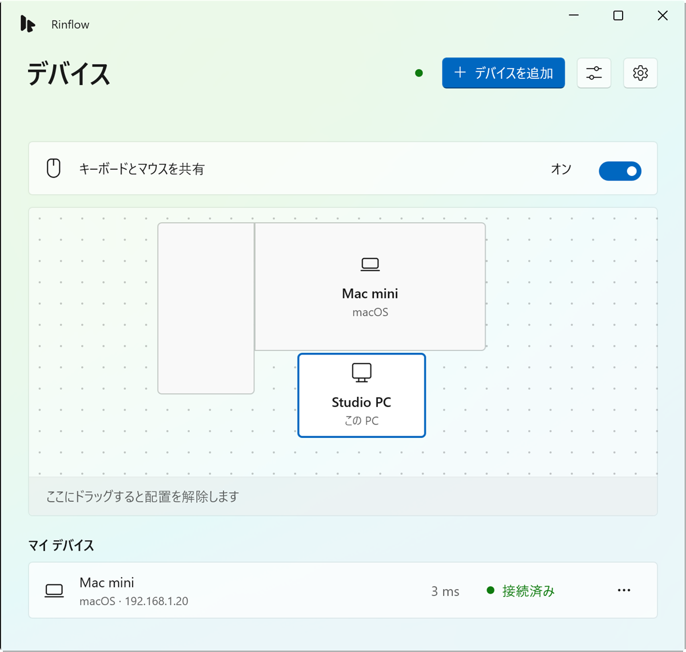

<p align="center">
  <picture>
    <source media="(prefers-color-scheme: dark)" srcset="app/Assets/Rinflow.Dark.svg">
    
  </picture>
</p>

<h1 align="center">Rinflow for Windows</h1>

<p align="center">
  Windows PC と Mac で、1 組のキーボードとマウスを共有します。<br>
  ポインターを画面の端の外へ動かすと、そのまま隣のデバイスを操作できます。
</p>

<p align="center">
  <a href="README.md">English</a> · <a href="README.zh-CN.md">简体中文</a> · <b>日本語</b>
</p>

<p align="center">
  <picture>
    <source media="(prefers-color-scheme: dark)" srcset="docs/images/devices-ja-JP-dark.png">
    
  </picture>
</p>

> [!NOTE]
> Rinflow は開発初期の段階です。バイナリのリリースはまだありません。既知の問題は[変更履歴](CHANGELOG.md)をご覧ください。

## 機能

- **画面の端で切り替え**：ポインターを画面の端の外へ押し出すと、隣のデバイスを操作できます。**Ctrl+Alt+Esc** で操作を戻せます。
- **デバイスの配置**：Windows のディスプレイ設定と同じように、デバイスをディスプレイの周りへドラッグします。
- **ペアリングと暗号化**：新しいデバイスは 6 桁のコードで確認し、すべての接続を TLS 1.3 で暗号化します。
- **クリップボードとファイル**：テキスト、画像、コピーしたファイルがポインターと一緒に移動します。任意で、既定ではオフです。
- **管理者ウィンドウとロック画面**：任意のサービスにより、操作側のデバイスから UAC の確認画面やロック画面も操作できます。
- **言語**：英語、簡体字中国語、日本語。

[Rinflow for macOS](https://github.com/rinflow-dev/rinflow-macos) と連携でき、[rinflow-core](https://github.com/rinflow-dev/rinflow-core) をベースにしています。

## 動作環境

- Windows 10 バージョン 1809 以降
- 同じローカル ネットワーク上で Rinflow を実行している別のコンピューター

## ソースからビルド

MSVC ツールチェーンの Rust と、C++ と WinUI のワークロードを含む Visual Studio または Build Tools 2026 が必要です。セットアップ プログラムの作成には Inno Setup 6 も必要です。詳しくは[ビルドと実行](docs/building.md)をご覧ください。

```powershell
git clone https://github.com/rinflow-dev/rinflow-core.git
git clone https://github.com/rinflow-dev/rinflow-windows.git
cd rinflow-windows
.\build.cmd -Configuration Release
.\installer\build-installer.ps1    # 任意：セットアップ プログラムを作成
```

## はじめに

1. 両方のコンピューターで Rinflow を起動します。
2. **デバイスを追加** を選択し、両方のコンピューターに同じ 6 桁のコードが表示されていることを確認します。
3. もう一方のコンピューターを、実際に置かれている画面の側へドラッグします。
4. ポインターをその端の外へ押し出します。

## ドキュメント（英語）

- [ビルドと実行](docs/building.md)
- [設計](docs/design.md)：各機能の仕組み、設定、エージェントの IPC プロトコル
- [クリップボードの実装](agent/docs/clipboard.md)

## コントリビュート

[CONTRIBUTING.md](CONTRIBUTING.md) をご覧ください。脆弱性の報告については [SECURITY.md](SECURITY.md) をご覧ください。

## ライセンス

[Mozilla Public License 2.0](LICENSE)。サードパーティ製ソフトウェアは [THIRD_PARTY_NOTICES.txt](THIRD_PARTY_NOTICES.txt) に記載しています。
