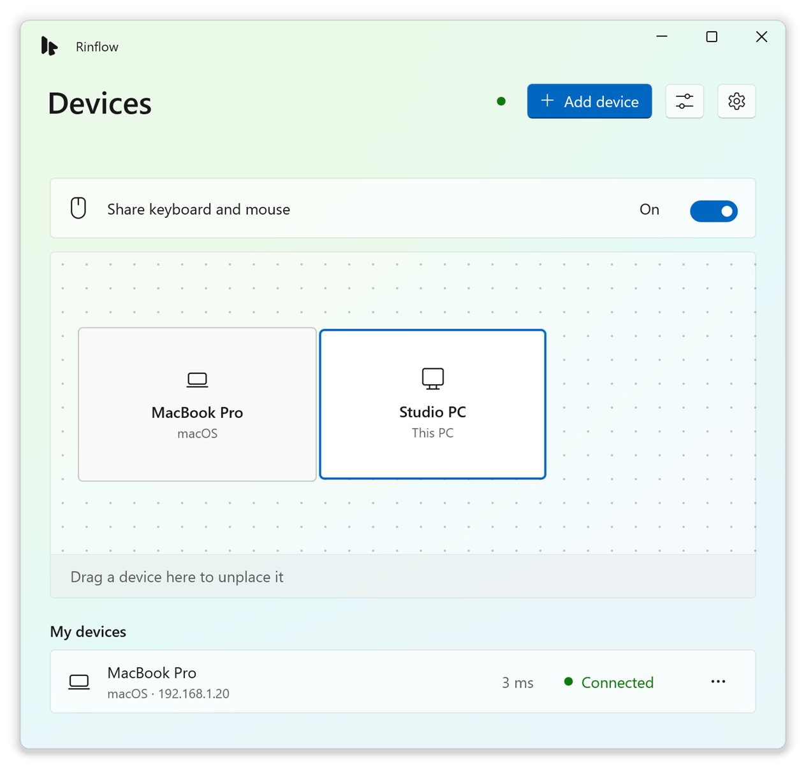

<p align="center">
  <picture>
    <source media="(prefers-color-scheme: dark)" srcset="app/Assets/Rinflow.Dark.svg">
    
  </picture>
</p>

<h1 align="center">Rinflow for Windows</h1>

<p align="center">
  One keyboard and mouse for your Windows PCs and Macs.<br>
  Move the pointer past a screen edge, and it continues on the next device.
</p>

<p align="center">
  <b>English</b> · <a href="README.zh-CN.md">简体中文</a> · <a href="README.ja.md">日本語</a>
</p>

<p align="center">
  <picture>
    <source media="(prefers-color-scheme: dark)" srcset="docs/images/devices-en-US-dark.png">
    
  </picture>
</p>

> [!NOTE]
> Rinflow is in early development. There are no binary releases yet, and known issues are listed in the [changelog](CHANGELOG.md).

## Features

- **Edge switching**: push the pointer past a screen edge to control the next device. **Ctrl+Alt+Esc** brings it back.
- **Arrangement**: drag devices into place around your monitors, as in the Windows display settings.
- **Pairing and encryption**: new devices confirm a six-digit code, and every connection uses TLS 1.3.
- **Clipboard and files**: text, images and copied files follow the pointer. Optional, off by default.
- **Admin windows and the lock screen**: an optional service lets a controlling device use UAC prompts and the lock screen.
- **Languages**: English, Simplified Chinese and Japanese.

Works with [Rinflow for macOS](https://github.com/rinflow-dev/rinflow-macos), and is built on [rinflow-core](https://github.com/rinflow-dev/rinflow-core).

## Requirements

- Windows 10 version 1809 or later
- Another computer running Rinflow, on the same local network

## Build from source

You need Rust with the MSVC toolchain, and Visual Studio or Build Tools 2026 with the C++ and WinUI workloads. The setup program also needs Inno Setup 6. Details are in [Building and running](docs/building.md).

```powershell
git clone https://github.com/rinflow-dev/rinflow-core.git
git clone https://github.com/rinflow-dev/rinflow-windows.git
cd rinflow-windows
.\build.cmd -Configuration Release
.\installer\build-installer.ps1    # optional: the setup program
```

## Getting started

1. Start Rinflow on both computers.
2. Select **Add device**, and check that both computers show the same six-digit code.
3. Drag the other computer to the side of your screen where it sits.
4. Push the pointer past that edge.

## Documentation

- [Building and running](docs/building.md)
- [Design](docs/design.md): how each feature works, the settings and the agent's IPC protocol
- [Clipboard implementation](agent/docs/clipboard.md)

## Contributing

See [CONTRIBUTING.md](CONTRIBUTING.md). To report a vulnerability, see [SECURITY.md](SECURITY.md).

## License

[Mozilla Public License 2.0](LICENSE). Third-party software is listed in [THIRD_PARTY_NOTICES.txt](THIRD_PARTY_NOTICES.txt).
