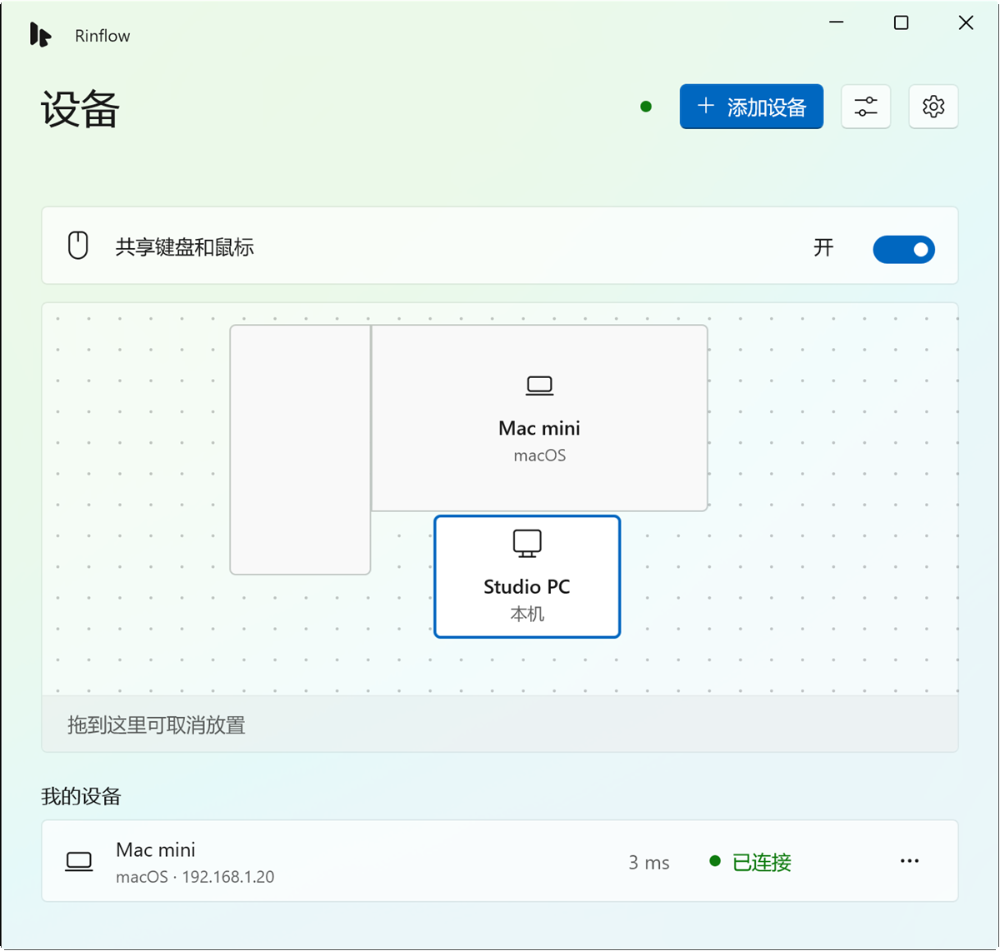

<p align="center">
  <picture>
    <source media="(prefers-color-scheme: dark)" srcset="app/Assets/Rinflow.Dark.svg">
    
  </picture>
</p>

<h1 align="center">Rinflow for Windows</h1>

<p align="center">
  让 Windows 电脑和 Mac 共用一套键盘和鼠标。<br>
  把指针移过屏幕边缘，就能接着操作下一台设备。
</p>

<p align="center">
  <a href="README.md">English</a> · <b>简体中文</b> · <a href="README.ja.md">日本語</a>
</p>

<p align="center">
  <picture>
    <source media="(prefers-color-scheme: dark)" srcset="docs/images/devices-zh-CN-dark.png">
    
  </picture>
</p>

> [!NOTE]
> Rinflow 处于早期开发阶段。已知问题见[变更日志](CHANGELOG.md)。

## 下载

从 [Releases](https://github.com/rinflow-dev/rinflow-windows/releases/latest) 下载适合你电脑的安装程序：

| 你的电脑 | 文件 |
| --- | --- |
| Intel 或 AMD 处理器 | `Rinflow-Setup-<版本>-x64.exe` |
| ARM 处理器（骁龙等） | `Rinflow-Setup-<版本>-arm64.exe` |

不确定选哪个？在 PowerShell 中运行下面的命令，它会自动识别、下载对应的文件，核对 SHA-256 后启动安装：

```powershell
irm https://raw.githubusercontent.com/rinflow-dev/rinflow-windows/main/scripts/install.ps1 | iex
```

安装程序暂未代码签名，运行前 Windows SmartScreen 会给出警告。

## 功能

- **越过边缘切换**：把指针推过屏幕边缘，即可控制下一台设备。按 **Ctrl+Alt+Esc** 收回控制。
- **设备排列**：像 Windows 显示设置一样，把设备拖到显示器周围。
- **配对与加密**：新设备需确认六位配对码，所有连接都使用 TLS 1.3 加密。
- **剪贴板和文件**：文字、图片和复制的文件随指针同步。可选，默认关闭。
- **管理员窗口与锁屏**：可选的服务让控制方也能操作 UAC 弹窗和锁屏。
- **多语言**：英语、简体中文和日语。

可与 [Rinflow for macOS](https://github.com/rinflow-dev/rinflow-macos) 配合使用，基于 [rinflow-core](https://github.com/rinflow-dev/rinflow-core) 构建。

## 系统要求

- Windows 10 1809 或更高版本
- 同一局域网中另一台运行 Rinflow 的电脑

## 从源码构建

需要 MSVC 工具链的 Rust，以及带 C++ 和 WinUI 工作负载的 Visual Studio 或 Build Tools 2026。生成安装程序还需要 Inno Setup 6。详情见[构建和运行](docs/building.md)。

```powershell
git clone https://github.com/rinflow-dev/rinflow-core.git
git clone https://github.com/rinflow-dev/rinflow-windows.git
cd rinflow-windows
.\build.cmd -Configuration Release
.\installer\build-installer.ps1    # 可选：生成安装程序
```

## 快速上手

1. 在两台电脑上启动 Rinflow。
2. 点击**添加设备**，确认两台电脑显示相同的六位配对码。
3. 把另一台电脑拖到它实际所在的屏幕一侧。
4. 把指针推过该边缘。

## 文档（英文）

- [构建和运行](docs/building.md)
- [设计](docs/design.md)：各功能的工作方式、设置项和 agent 的 IPC 协议
- [剪贴板实现](agent/docs/clipboard.md)

## 参与贡献

见 [CONTRIBUTING.md](CONTRIBUTING.md)。报告安全漏洞见 [SECURITY.md](SECURITY.md)。

## 许可证

[Mozilla Public License 2.0](LICENSE)。第三方软件见 [THIRD_PARTY_NOTICES.txt](THIRD_PARTY_NOTICES.txt)。
